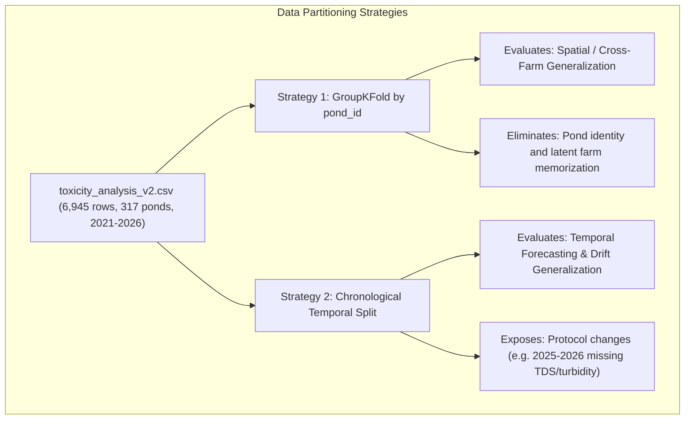

# Data Split & Group Partitioning Summary

**Project:** AI-Based Precision Aquaculture Toxicity and Yield Prediction System  
**Experiment Identifier:** `baseline_toxicity_v1`  
**Execution Phase:** Pre-Modeling Data Splitting & Validation Audit  
**Status:** **AUDITED & FROZEN — NO MODELS TRAINED**  

---

## 1. Validation Strategy Overview: Two Complementary Evaluation Axes

In precision aquaculture machine learning, a single validation strategy cannot simultaneously evaluate spatial generalization (unseen farms) and temporal generalization (future seasons). 

To ensure comprehensive, leak-free evaluation without silently replacing one strategy with another, this report documents **two distinct validation strategies**:

1. **GroupKFold by `pond_id`:** Measures **Spatial / Cross-Farm Generalization**. Disjointly partitions ponds so that no pond appears in both training and validation folds.
2. **Chronological Temporal Split:** Measures **Temporal Forecasting & Regime Drift Generalization**. Evaluates how a model trained on historical seasons performs on future production cycles, exposing real-world protocol shifts.

> [!IMPORTANT]
> **REJECTION OF SIMPLE RANDOM SPLITTING:**  
> Standard random splitting (`train_test_split` or standard k-fold CV) is **strictly prohibited**. Multiple measurements from the same pond share unobserved latent factors (pond depth, soil chemistry, aeration infrastructure, farmer feeding behavior). Random splitting causes severe pond-memorization leakage and produces deceptively high $R^2$ scores that collapse upon deployment on new farms.

---

## 2. Strategy 1: GroupKFold by `pond_id` (Spatial Cross-Farm Validation)

### 2.1 GroupKFold on Full Dataset ($N = 6,945$, 317 Ponds)
Applied across Experiment 1 (Soft-Sensor Ammonia Regression) and Experiment 2 (Mortality Classification). The 317 unique ponds are partitioned into 5 disjoint groups ($K = 5$):

| Fold Identifier | Record Count ($N$) | Unique Ponds | Exp 2 Mortalities (`DeadFish > 0`) | Mortality Rate (%) | Exp 1 NH3 Mean ($\text{mg/L}$) | Exp 1 NH3 Median ($\text{mg/L}$) | Zero Positive Check |
| :---: | :---: | :---: | :---: | :---: | :---: | :---: | :---: |
| **Fold 1** | 1,389 | 63 | **17** | 1.22% | 0.0255 | 0.0158 | **Passed** ($\ge 1$ positive) |
| **Fold 2** | 1,389 | 63 | **19** | 1.37% | 0.0210 | 0.0118 | **Passed** ($\ge 1$ positive) |
| **Fold 3** | 1,389 | 63 | **15** | 1.08% | 0.0175 | 0.0106 | **Passed** ($\ge 1$ positive) |
| **Fold 4** | 1,389 | 64 | **18** | 1.30% | 0.0185 | 0.0084 | **Passed** ($\ge 1$ positive) |
| **Fold 5** | 1,389 | 64 | **6** | 0.43% | 0.0230 | 0.0107 | **Passed** ($\ge 1$ positive) |
| **Total / Global** | **6,945** | **317** | **75** | **1.08%** | **0.0211** | **0.0116** | **All Folds Valid** |

> [!NOTE]
> **POSITIVE CASE VERIFICATION FOR EXPERIMENT 2:**  
> - Despite severe overall class imbalance (75 positive cases out of 6,945 records, or $1.08\%$), **every single fold contains positive mortality cases** (Fold 1: 17, Fold 2: 19, Fold 3: 15, Fold 4: 18, Fold 5: 6).  
> - **No fold lacks positive cases.**

### 2.2 GroupKFold on Experiment 3 Valid Consecutive Pairs ($N = 4,900$, 303 Ponds)
For Experiment 3 (Next-Visit Ammonia Risk with $3 \le \Delta t \le 45\text{ days}$), the 303 ponds are partitioned into 5 disjoint folds:

| Fold Identifier | Pair Count ($N$) | Unique Ponds | Next-Visit Risk Positives ($y_{t+1}=1$) | Positive Risk Rate (%) | Zero Positive Check |
| :---: | :---: | :---: | :---: | :---: | :---: |
| **Fold 1** | 980 | 60 | **63** | 6.43% | **Passed** ($\ge 1$ positive) |
| **Fold 2** | 980 | 60 | **56** | 5.71% | **Passed** ($\ge 1$ positive) |
| **Fold 3** | 980 | 61 | **58** | 5.92% | **Passed** ($\ge 1$ positive) |
| **Fold 4** | 980 | 61 | **61** | 6.22% | **Passed** ($\ge 1$ positive) |
| **Fold 5** | 980 | 61 | **76** | 7.76% | **Passed** ($\ge 1$ positive) |
| **Total / Global** | **4,900** | **303** | **314** | **6.41%** | **All Folds Valid** |

> [!NOTE]
> **POSITIVE CASE VERIFICATION FOR EXPERIMENT 3:**  
> - Every fold contains between 56 and 76 positive next-visit high-risk events.  
> - **No fold lacks positive cases.** Sample size across all folds is statistically sufficient for cross-validated scoring.

---

## 3. Strategy 2: Chronological Temporal Split (Forecasting & Drift Validation)

### 3.1 Dataset Longitudinal Profile (2021 to 2026)
The dataset spans 5 years and 1 month of monitoring:
- **Earliest Timestamp:** `2021-07-04 08:20:00`
- **Latest Timestamp:** `2026-08-06 07:13:00`

Annual breakdown of observations, unique ponds, mortality occurrences, and ammonia levels:

| Year | Record Count | Share (%) | Active Ponds | Mortalities (`DeadFish > 0`) | Target NH3 Mean ($\text{mg/L}$) | Target NH3 Median ($\text{mg/L}$) | Operational Context |
| :---: | :---: | :---: | :---: | :---: | :---: | :---: | :--- |
| **2021** | 309 | 4.45% | 55 | 0 | 0.0062 | 0.0024 | Initial pilot setup; low baseline ammonia. Mortalities not tallied. |
| **2022** | 1,431 | 20.60% | 96 | 0 | 0.0255 | 0.0163 | Full field deployment; complete TDS/turbidity records. |
| **2023** | 1,082 | 15.58% | 116 | 17 | 0.0196 | 0.0108 | Mortality logging initiated mid-year; high data completeness. |
| **2024** | 1,523 | 21.93% | 189 | 14 | 0.0257 | 0.0145 | Peak farm enrollment; emerging missingness in TDS (38%). |
| **2025** | 1,563 | 22.51% | 156 | 29 | 0.0210 | 0.0135 | **Protocol Shift:** TDS and Turbidity ceased ($100\%$ missing). |
| **2026** | 1,037 | 14.93% | 133 | 15 | 0.0144 | 0.0076 | Continued operation; TDS/Turbidity 100% missing. |
| **Total** | **6,945** | **100.00%** | **317** | **75** | **0.0211** | **0.0116** | Full longitudinal horizon. |

### 3.2 Candidate Chronological Partition Schemes
Two chronological splits provide meaningful evaluation benchmarks:

#### Option A: Post-2024 Operational Cutoff (`Cutoff: 2025-01-01`)
- **Training Set (2021–2024):** $4,345\text{ records}$ ($62.56\%$), 239 active ponds, 31 positive mortality events. High sensor completeness.
- **Testing Set (2025–2026):** $2,600\text{ records}$ ($37.44\%$), 44 active ponds, 44 positive mortality events.
- **What this measures:** **Resilience to Sensor Cessation & Operational Drift.** Evaluates whether models trained during the sensor-rich period (2021–2024) degrade or maintain predictive utility when deployed during the 2025–2026 period where TDS and Turbidity are completely missing.

#### Option B: Mid-Program Cutoff (`Cutoff: 2024-01-01`)
- **Training Set (2021–2023):** $2,822\text{ records}$ ($40.63\%$), 148 active ponds, 17 positive mortality events.
- **Testing Set (2024–2026):** $4,123\text{ records}$ ($59.37\%$), 268 active ponds, 58 positive mortality events.
- **What this measures:** **Pure Temporal Extrapolation.** Evaluates standard forward-looking predictive ability across multi-year cycles.

---

## 4. Methodological Distinction & Summary Comparison

| Evaluation Dimension | Strategy 1: GroupKFold by `pond_id` | Strategy 2: Chronological Split |
| :--- | :--- | :--- |
| **Primary Question** | "Will the model generalize to newly enrolled ponds and farms?" | "Will the model continue to perform reliably in future monitoring years?" |
| **Primary Threat Evaluated** | Spatial overfitting & farm-specific latent memorization | Temporal concept drift, seasonal shifts & sensor protocol cessation |
| **Partitioning Key** | `pond_id` (independent pond groups) | `datetime` (time threshold) |
| **Pond Overlap** | **Zero overlap** ($\text{Train} \cap \text{Test} = \emptyset$) | Significant pond overlap (same ponds tracked over time) |
| **Positive Case Status** | All 5 folds contain positive cases for Exp 2 and Exp 3 | Both partitions contain positive cases for Exp 2 and Exp 3 |

---

## 5. Audit Report on Extra CSV Files

During the initial baseline preparation, two dataset files were generated:
1. [`baseline_toxicity_v1/train_toxicity_v1.csv`](file:///d:/AI-Based-Precision-Aquaculture-Toxicity-and-Yield-Prediction-System/baseline_toxicity_v1/train_toxicity_v1.csv) (5,727 rows $\times$ 11 cols)
2. [`baseline_toxicity_v1/test_toxicity_v1.csv`](file:///d:/AI-Based-Precision-Aquaculture-Toxicity-and-Yield-Prediction-System/baseline_toxicity_v1/test_toxicity_v1.csv) (1,218 rows $\times$ 11 cols)

**Formal Audit Finding:**
- These two CSV files represent a single-split `GroupShuffleSplit(test_size=0.20, random_state=42)` holdout partition (253 train ponds, 64 test ponds).
- In accordance with instructions, **these files are formally identified as extra files outside the core requested documentation deliverables**.
- They have **NOT been deleted or modified**, and **no models have been fitted or evaluated using them**. They remain preserved and frozen in place for review.
