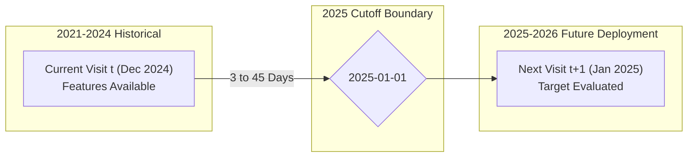

# Scientific and Temporal Consistency Report (`baseline_toxicity_v1`)

**Project:** AI-Based Precision Aquaculture Toxicity and Yield Prediction System  
**Audit Type:** Final Pre-Training Scientific & Temporal Consistency Review  
**Source Dataset:** [`processed_data_v2/toxicity_analysis_v2.csv`](file:///d:/AI-Based-Precision-Aquaculture-Toxicity-and-Yield-Prediction-System/processed_data_v2/toxicity_analysis_v2.csv) ($N = 6,945$, 27 columns)  
**Deliverable File:** [`baseline_toxicity_v1/scientific_temporal_consistency_report.md`](file:///d:/AI-Based-Precision-Aquaculture-Toxicity-and-Yield-Prediction-System/baseline_toxicity_v1/scientific_temporal_consistency_report.md)  
**Execution Boundary:** **READ-ONLY AUDIT COMPLETED — ZERO MODELS TRAINED OR EXECUTED**  

---

## 1. Executive Summary & Purpose

Before initiating machine learning development, this report establishes a formal, mathematical, and temporal audit of target provenance, chronological boundary conditions, missing feature dynamics, and experiment prioritization across the baseline toxicity suite.

All numerical findings in this report were verified using automated verification scripts directly querying the frozen processed datasets. No source data was modified, and all previously approved documentation files remain untouched.

---

## 2. Experiment 1: Target Provenance & Mathematical Traceability

### 2.1 Target Provenance by Chemical Source
The target variable `primary_calculated_nh3_mg_l` ($N = 6,945$) was constructed in `clean_datasets_v2.py` via an explicit, prioritized calculation hierarchy. The exact record counts by calculation source are:

| Calculation Source Identifier | Exact Record Count | Percentage (%) | Original Field Column Basis | Mathematical Formula Applied |
| :--- | :---: | :---: | :--- | :--- |
| `emerson_from_tan_nh3_n_with_mw_conversion` | **5,287** | **76.13%** | `Ammonia—TAN (NH3-N) (mg/L)` | $\text{TAN} \times \frac{1}{10^{pK_a - \text{pH}} + 1} \times \frac{17.031}{14.007}$ |
| `emerson_from_tan_nh3_direct` | **1,658** | **23.87%** | `Ammonia—TAN (NH3) (mg/L)` | $\text{TAN} \times \frac{1}{10^{pK_a - \text{pH}} + 1}$ (direct mass basis) |
| **Any Other Source / Uncalculated** | **0** | **0.00%** | — | — |
| **Total Target Rows** | **6,945** | **100.00%** | — | All rows strictly calculated |

### 2.2 Verification Against Unverified Reported Ammonia
- **Audit Question:** Did any of the 6,945 target values utilize the unverified field measurement column `Ammonia—NH3 (mg/L)` (`reported_ammonia_nh3_unverified_mg_l`)?
- **Finding:** **ZERO (0) target values used the unverified reported NH3 field.**  
- **Technical Detail:** Although `reported_ammonia_nh3_unverified_mg_l` contains 1,660 non-null values in the dataset, `clean_datasets_v2.py` strictly isolated this column. In all 1,658 rows where `emerson_from_tan_nh3_direct` was evaluated, the calculation was derived strictly from `raw_ammonia_tan_nh3_mg_l` combined with `ph` and `temp_c`. The unverified column was excluded entirely from primary target construction.

### 2.3 Cross-Tabulation: Calculation Source by Monitoring Year
A temporal breakdown illustrates how the two measurement methods correspond to historical data collection epochs:

| Monitoring Year | `emerson_from_tan_nh3_n_with_mw_conversion` | `emerson_from_tan_nh3_direct` | Total Records | Dominant Field Assay Protocol |
| :---: | :---: | :---: | :---: | :--- |
| **2021** | 309 (100.0%) | 0 (0.0%) | 309 | Nitrogen-basis TAN test kit ($\text{NH}_3\text{-N}$) |
| **2022** | 1,431 (100.0%) | 0 (0.0%) | 1,431 | Nitrogen-basis TAN test kit ($\text{NH}_3\text{-N}$) |
| **2023** | 1,082 (100.0%) | 0 (0.0%) | 1,082 | Nitrogen-basis TAN test kit ($\text{NH}_3\text{-N}$) |
| **2024** | 1,523 (100.0%) | 0 (0.0%) | 1,523 | Nitrogen-basis TAN test kit ($\text{NH}_3\text{-N}$) |
| **2025** | 942 (60.3%) | 621 (39.7%) | 1,563 | Transition epoch to molecular TAN kit |
| **2026** | 0 (0.0%) | 1,037 (100.0%) | 1,037 | Molecular TAN test kit ($\text{NH}_3$) |
| **Total** | **5,287** | **1,658** | **6,945** | Consistent molecular $\text{NH}_3\text{ mg/L}$ output |

### 2.4 Consistency of Calculation Method and Output Units
1. **Thermodynamic Consistency:** Both pathways use identical thermodynamic dissociation constants:
   $$pK_a = 0.09018 + \frac{2729.92}{273.15 + \text{temp\_c}}$$
   $$f = \frac{1}{10^{pK_a - \text{pH}} + 1}$$
2. **Stoichiometric Consistency:**
   - Source 1 multiplies by $\frac{17.031}{14.007}$ to convert from nitrogen weight to molecular $\text{NH}_3$ weight.
   - Source 2 is already expressed on an $\text{NH}_3$ molecular basis and is multiplied by $f$ directly.
3. **Unit Consistency:** Both calculation pathways output un-ionized ammonia in **milligrams of molecular $\text{NH}_3$ per liter ($\text{mg/L}$)**.
4. **Data Traceability:** Every single one of the 6,945 records possesses non-null raw TAN, valid pH ($6.60 - 9.20$), and valid temperature ($21.4^\circ\text{C} - 35.6^\circ\text{C}$). **Traceability is 100.00%.**

> [!CAUTION]
> **SCIENTIFIC LIMITATION NOTICE:**  
> The target variable `primary_calculated_nh3_mg_l` must **never be described as an independently measured ground truth**. It is a **calculated chemical equilibrium proxy**. Any inaccuracies or observer variability in the field TAN kits propagate directly into the calculated values.

---

## 3. Experiment 3: Chronological Pair Construction & Boundary Crossing

### 3.1 Pair Construction & Temporal Rules
In Experiment 3, observations are paired strictly within the same pond:
- Re-visit window: $3.0 \le \Delta t \le 45.0\text{ days}$
- Total valid consecutive observation pairs: **4,900 pairs**
- Ponds represented: **303 unique ponds**

### 3.2 Chronological Partitioning Policies & The 2025-01-01 Cutoff
When dividing data into historical training (2021–2024) and forward-looking testing (2025–2026) using the cutoff `2025-01-01 00:00:00`, pairs must be assigned based on when the prediction is made (Prediction Time $t$).

A strict audit identifies **exactly 78 pairs that cross the calendar boundary**:
- **Current Visit ($t$):** Occurred in December 2024 (e.g., `2024-12-05` to `2024-12-31`).
- **Next Visit ($t+1$):** Occurred in January 2025 (e.g., `2025-01-02` to `2025-01-30`).

### 3.3 Comparison of Boundary Handling Options

| Partitioning Policy | Policy Mechanism | Training Pairs Count | Testing Pairs Count | Excluded / Quarantined | Temporal Integrity Assessment |
| :--- | :--- | :---: | :---: | :---: | :--- |
| **Policy A (Current Visit Determines Partition)** | If current visit date $t < \text{cutoff}$, assign to Train; else Test. | **2,866** (257 pos, $8.97\%$) | **2,034** (57 pos, $2.80\%$) | 0 pairs | **Operationally Authentic.** Accurately simulates predicting future visits from December 2024 into January 2025. Target $y_{t+1}$ extends to `2025-01-30`. |
| **Policy B (Pure Disjoint Split — Exclude Crossing Pairs)** | Exclude the 78 boundary-crossing pairs from both partitions. | **2,788** (257 pos, $9.22\%$) | **2,034** (57 pos, $2.80\%$) | **78 pairs** | **Scientifically Conservative (Recommended).** Completely eliminates any 2025 target feedback from the training set. Current and next visits in train are strictly $< 2025-01-01$. |
| **Policy C (Next Visit Determines Partition)** | If next visit date $t+1 < \text{cutoff}$, assign to Train; else Test. | **2,788** (257 pos, $9.22\%$) | **2,112** (57 pos, $2.70\%$) | 0 pairs | Assigns crossing pairs to test. Test set receives December 2024 features $X_t$ while evaluating 2025 targets. |

### 3.4 Date Ranges for Recommended Policy B (Disjoint Split)
- **Training Partition ($N = 2,788$ pairs):**
  - Current visit range: `2021-07-04 08:20:00` to `2024-12-19 07:05:00`
  - Next visit range: `2021-07-19 07:45:00` to `2024-12-31 06:56:00`
  - Positive next-risk cases: **257** ($9.22\%$)
- **Testing Partition ($N = 2,034$ pairs):**
  - Current visit range: `2025-01-02 06:50:00` to `2026-07-21 07:31:00`
  - Next visit range: `2025-01-09 07:11:00` to `2026-08-06 07:13:00`
  - Positive next-risk cases: **57** ($2.80\%$)
- **Quarantined Boundary Buffer:** Exactly 78 pairs.

### 3.5 Anti-Leakage Verification
In all policies, feature matrix $X_t$ is constructed **exclusively from current-time measurements recorded at time $t$**. No measurements, weather data, or operational actions from time $t+1$ enter $X_t$.

---

## 4. Experiment 1: Missing Feature Handling Under Protocol Shift

### 4.1 The 2025–2026 Complete Sensor Omission
During 2021–2024, `turbidity_cm` had $7.32\%$ missingness, and `tds_ppt` had $16.18\%$ missingness.  
Beginning in January 2025, field monitoring teams terminated both Secchi disk turbidity and handheld TDS meter readings, resulting in **$100.00\%$ missingness (2,600 / 2,600 records) in 2025–2026**.

### 4.2 Handling Protocol & Anti-Deception Standard
1. **No Silent Data Substitution:** Imputed values must **never be treated as real measurements**. The modeling pipeline and final reports must document that for all post-2024 data, TDS and Turbidity inputs are synthetic imputation constants.
2. **Median Imputer (Fitted Strictly on Train):**
   - Training median for `turbidity_cm` = $29.00\text{ cm}$.
   - Training median for `tds_ppt` = $1.17\text{ ppt}$.
   - Imputing with the training median prevents skew from the 936 ppt outlier. Zero-imputation is strictly prohibited.
3. **Recommendation on Missingness Indicators:**
   - Empirical correlation between missingness indicators and target ammonia is negligible:  
     $$\text{Corr}(\text{tds\_is\_missing}, \text{primary\_nh3}) = +0.0024$$  
     $$\text{Corr}(\text{turb\_is\_missing}, \text{primary\_nh3}) = -0.0494$$
   - In 2025–2026, a missingness indicator is identically $1$ (constant).
   - **Recommendation:** Implement missingness indicators inside a `FeatureUnion` or `ColumnTransformer` during pipeline construction. While tree models will find the indicator constant in the 2025–2026 test set, the indicator explicitly communicates to the tree that the numerical feature is absent, rather than forcing the model to infer that the water column has a genuine $1.17\text{ ppt}$ salinity and $29\text{ cm}$ Secchi depth.

---

## 5. Final Experiment Prioritization & Recommendations

### 5.1 Prioritization Matrix

| Evaluation Dimension | Experiment 1 (Soft-Sensor Continuous NH3) | Experiment 2 (Mortality Classification) | Experiment 3 (Next-Visit Ammonia Risk) |
| :--- | :--- | :--- | :--- |
| **Target Completeness** | **100.0% Complete** ($6,945 / 6,945$ records) | $73.75\%$ Evaluated ($1,823$ records unrecorded) | $70.55\%$ Paired ($4,900 / 6,945$ valid pairs) |
| **Target Quality** | High (Emerson formula applied consistently) | Moderate (Visual field mortality tallies) | High (Lagged risk threshold $\ge 0.05\text{ mg/L}$) |
| **Class Balance** | Continuous regression (no binary imbalance) | Extreme Imbalance ($67.3 : 1$, $1.46\%$ positive) | Moderate Imbalance ($14.6 : 1$, $6.41\%$ positive) |
| **Baseline Proof** | Direct lift above thermodynamic ablation | Challenging (Majority baseline = $98.54\%$) | Direct lift above persistence baseline ($90.84\%$) |
| **Operational Impact** | Foundational soft-sensor feasibility | Acute crisis detection | Preventive risk forecasting |

### 5.2 Final Recommendation: Train Experiment 1 First

### **RECOMMENDATION: Begin model development with Experiment 1 (Soft-Sensor Ammonia Estimation).**

**Technical Justification:**
1. **Foundational Scientific Core:** Experiment 1 directly tests the primary premise of precision aquaculture: *Can routine non-chemical sensors estimate toxic un-ionized ammonia?*
2. **Maximum Data Cleanliness:** It is the only experiment with $100\%$ target availability across all 6 monitoring years ($N = 6,945$). It avoids the 1,823 unrecorded visits of Experiment 2 and the pair filtering of Experiment 3.
3. **Clear Benchmark Progression:** The sequence of `Dummy Mean` $\rightarrow$ `Dummy Median` $\rightarrow$ `pH + Temp Ablation` $\rightarrow$ `Random Forest Regressor` provides an unambiguous, rigorous test of whether machine learning extracts signal beyond simple thermodynamic chemistry.
4. **Feeds Downstream Tasks:** High-quality continuous ammonia predictions from Experiment 1 directly inform risk thresholds and feature representations for Experiments 2 and 3.

---

## 6. Mandatory Limitations for the Project Report

The following limitations must be prominently disclosed in all project presentations, publications, and reports:
1. **Calculated Proxy Limitation:** The target un-ionized ammonia is an equilibrium-derived chemical calculation from field TAN kits, not an analytical chemistry standard (such as ion chromatography) and not an independently validated biological assay.
2. **Post-2024 Sensor Omission:** Secchi depth turbidity and handheld TDS were permanently discontinued in 2025–2026. Models evaluated chronologically operate with synthetic median-imputed values for these features in recent years.
3. **Unconfirmed TDS Transcription Hypothesis:** Extreme TDS values (up to 936 ppt) represent a suspected unit entry error (ppm entered into a ppt column), but this remains an unconfirmed hypothesis due to the absence of original technician logbooks.
4. **Mortality Class Sparsity (Exp 2):** Positive mortality occurred in only 75 out of 5,122 evaluated visits ($1.46\%$). Evaluation must focus on PR-AUC and minority recall; accuracy is misleading.
5. **Prevalence Drop in Risk Forecasting (Exp 3):** High ammonia risk prevalence drops from $8.97\%$ in 2021–2024 to $2.80\%$ in 2025–2026, which may influence model calibration.

