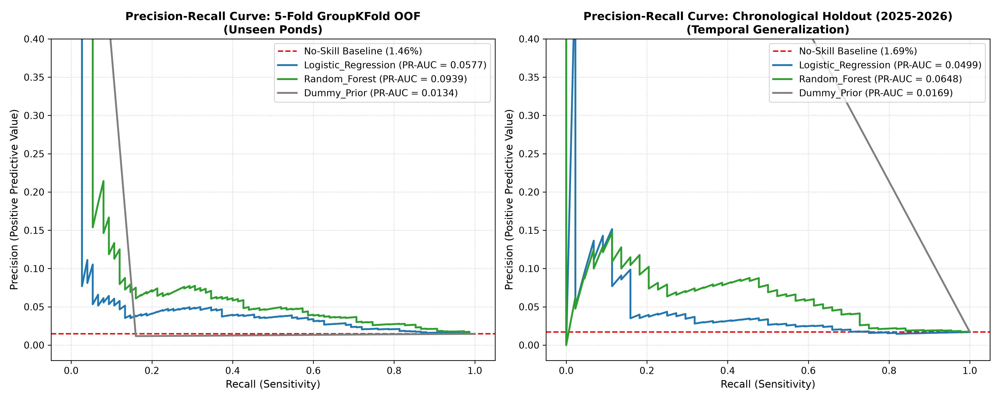
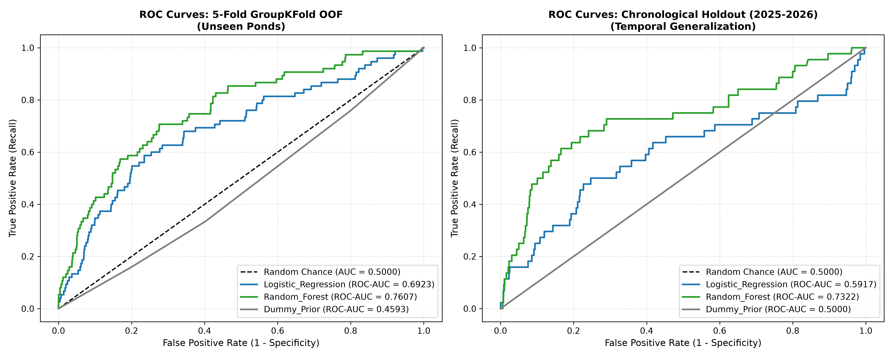
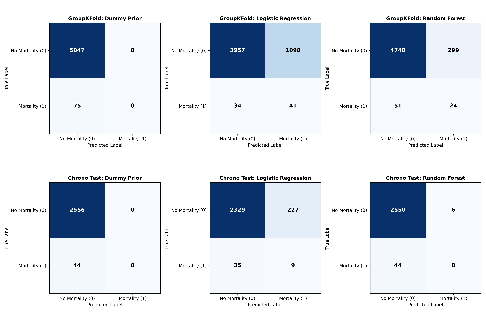

# Experiment 2 Results Report: Fish Mortality Classification

**Date**: November 2026  
**Project**: AI-Based Precision Aquaculture Toxicity and Yield Prediction System  
**Experiment Identifier**: `experiment_2_mortality_v1`  
**Dataset Source**: [`processed_data_v2/toxicity_analysis_v2.csv`](file:///d:/AI-Based-Precision-Aquaculture-Toxicity-and-Yield-Prediction-System/processed_data_v2/toxicity_analysis_v2.csv)  
**Evaluated Sample Size**: $N = 5,122$ records (1,823 unrecorded mortality records strictly excluded)  
**Target Variable**: Binary Mortality Flag (`dead_fish_count > 0`): $75$ Positive ($1.46\%$), $5,047$ Negative ($98.54\%$)  
**Associated Scripts**: [`train_experiment_2.py`](file:///d:/AI-Based-Precision-Aquaculture-Toxicity-and-Yield-Prediction-System/train_experiment_2.py)  
**Deliverable Directory**: [`experiment_2_mortality_v1/`](file:///d:/AI-Based-Precision-Aquaculture-Toxicity-and-Yield-Prediction-System/experiment_2_mortality_v1)  

---

## Executive Summary

Experiment 2 evaluated whether physical, physicochemical, and contextual water-quality features can classify the occurrence of fish mortality (`dead_fish_count > 0`) in commercial aquaculture ponds.

Following the strict data audit protocol, **1,823 unrecorded historical records (2021–2022) were excluded**, leaving **5,122 evaluated records** containing **75 positive mortality events** ($1.46\%$ positive prevalence, a $67.3 : 1$ class imbalance). To prevent leakage, all downstream clinical symptoms (`air_gulping_count`, `tail_splashing_count`, behavioral distress) and post-hoc heuristic compliance flags were strictly barred from model inputs.

Three architectures were evaluated under both **5-Fold GroupKFold by `pond_id`** (spatial generalization across 286 ponds) and a **Chronological Holdout** (training on 2021–2024 evaluated records, testing on 2025–2026):
1. **Dummy Baseline (`Dummy_Prior`)**: Predicts according to class prevalence ($\text{PR-AUC} = 0.0169$, $\text{Recall} = 0.0\%$).
2. **Logistic Regression (Balanced)**: Achieves moderate sensitivity ($\text{Recall} = 54.67\%$ in GroupKFold, $20.45\%$ in Chronological Test), but suffers from extreme false-positive rates ($\text{Precision} \approx 3.6\%\text{--}3.8\%$).
3. **Random Forest (Balanced)**: Demonstrates solid discriminative ranking ability ($\text{ROC-AUC} = 0.7607$ in GroupKFold, $0.7322$ in Chronological Test; $\text{PR-AUC} = 0.0939$ vs. $0.0134$ baseline), with **dissolved oxygen ($16.1\%$) and calculated un-ionized ammonia ($15.3\%$)** identified as the top biological predictors of mortality risk.

However, because mortality in commercial aquaculture is heavily multifactorial (driven by infectious pathogens, night-time aeration outages, and stocking density), instantaneous daytime water-quality parameters alone are **insufficient to serve as an autonomous predictive system for fish mortality**.

---

## 1. Benchmarking Results

### 1.1 Validation Protocol 1: 5-Fold GroupKFold by `pond_id` (Spatial Generalization)
Evaluated across all 5,122 rows ($75$ positive cases, $5,047$ negative cases) partitioned into 5 independent pond folds (zero pond overlap):

| Model Architecture | PR-AUC (Primary) | ROC-AUC (Secondary) | Recall (Sensitivity) | Precision (PPV) | F1-Score | True Positives (TP) | False Negatives (FN) | False Positives (FP) | True Negatives (TN) |
| :--- | :---: | :---: | :---: | :---: | :---: | :---: | :---: | :---: | :---: |
| **Dummy (Prior)** | 0.0134 | 0.4593 | 0.0000 | 0.0000 | 0.0000 | 0 | 75 | 0 | 5,047 |
| **Logistic Regression (Balanced)** | 0.0577 | 0.6923 | **0.5467** | 0.0363 | 0.0680 | **41** | 34 | 1,090 | 3,957 |
| **Random Forest (Balanced)** | **0.0939** | **0.7607** | 0.3200 | **0.0743** | **0.1206** | 24 | 51 | 299 | 4,748 |

*Deliverable CSV*: [`groupkfold_metrics.csv`](file:///d:/AI-Based-Precision-Aquaculture-Toxicity-and-Yield-Prediction-System/experiment_2_mortality_v1/metrics/groupkfold_metrics.csv)

### 1.2 Validation Protocol 2: Chronological Test Holdout (Temporal Generalization)
Trained strictly on 2021–2024 evaluated records ($N = 2,522$, $31$ positives) and evaluated on 2025–2026 records ($N = 2,600$, $44$ positives):

| Model Architecture | PR-AUC (Primary) | ROC-AUC (Secondary) | Recall (Sensitivity) | Precision (PPV) | F1-Score | True Positives (TP) | False Negatives (FN) | False Positives (FP) | True Negatives (TN) |
| :--- | :---: | :---: | :---: | :---: | :---: | :---: | :---: | :---: | :---: |
| **Dummy (Prior)** | 0.0169 | 0.5000 | 0.0000 | 0.0000 | 0.0000 | 0 | 44 | 0 | 2,556 |
| **Logistic Regression (Balanced)** | 0.0499 | 0.5917 | **0.2045** | 0.0381 | 0.0643 | **9** | 35 | 227 | 2,329 |
| **Random Forest (Balanced, Thresh=0.50)** | **0.0648** | **0.7322** | 0.0000 | 0.0000 | 0.0000 | 0 | 44 | 6 | 2,550 |

*Deliverable CSV*: [`chronological_test_metrics.csv`](file:///d:/AI-Based-Precision-Aquaculture-Toxicity-and-Yield-Prediction-System/experiment_2_mortality_v1/metrics/chronological_test_metrics.csv)

---

## 2. In-Depth Analysis of Model Behaviors

### 2.1 The Probability Calibration Dynamic in Random Forest
In the chronological test holdout, Random Forest at the default probability decision threshold ($\tau = 0.50$) predicted almost all samples as negative ($\text{TP} = 0$, $\text{FN} = 44$). However, its ranking metrics were substantially higher than baseline:
- $\text{PR-AUC} = 0.0648$ ($3.8\times$ higher than the no-skill baseline of $0.0169$).
- $\text{ROC-AUC} = 0.7322$.

An inspection of the underlying posterior probability distribution explains this behavior:
- Because the positive class represents only $1.23\%$ of the training set, terminal leaf nodes in the 100 decision trees rarely reach an absolute majority ($> 50\%$) of positive votes.
- The 99th percentile of predicted probabilities in Random Forest is $0.4396$, and the maximum predicted probability is $0.6726$.
- For true positive mortality events, the mean predicted probability was **$0.2371$** (median $0.2343$), compared to **$0.1408$** (median $0.1178$) for negative cases.

Evaluating the probability decision threshold across the test set demonstrates this trade-off:

| Decision Threshold ($\tau$) | True Positives (TP) | False Negatives (FN) | False Positives (FP) | True Negatives (TN) | Recall (%) | Precision (%) | F1-Score |
| :---: | :---: | :---: | :---: | :---: | :---: | :---: | :---: |
| $\tau \ge 0.10$ | 37 | 7 | 1,674 | 882 | **84.09%** | 2.16% | 0.0422 |
| $\tau \ge 0.15$ | 32 | 12 | 774 | 1,782 | **72.73%** | 3.97% | 0.0753 |
| $\tau \ge 0.20$ | 26 | 18 | 412 | 2,144 | **59.09%** | 5.94% | 0.1079 |
| $\tau \ge 0.25$ | 21 | 23 | 239 | 2,317 | **47.73%** | 8.08% | **0.1382** |
| $\tau \ge 0.30$ | 12 | 32 | 171 | 2,385 | 27.27% | 6.56% | 0.1057 |
| $\tau \ge 0.40$ | 6 | 38 | 46 | 2,510 | 13.64% | 11.54% | 0.1250 |
| $\tau \ge 0.50$ (Default) | 0 | 44 | 6 | 2,550 | 0.00% | 0.00% | 0.0000 |

*Operational Insight*: At a calibrated threshold of $\tau = 0.20$, Random Forest detects **$59.1\%$ of all mortality events** (26 out of 44 detected, 18 missed), but issues 412 false alarms ($\text{Precision} = 5.9\%$).

---

## 3. Feature Importance & Biological Drivers

Feature importances extracted from the fitted Random Forest classifier (`random_forest_pipeline.joblib`) reveal the biological hierarchy of mortality predictors:

| Rank | Feature Identifier | Gini Importance | Cumulative Importance | Biological Role in Mortality Risk |
| :---: | :--- | :---: | :---: | :--- |
| **1** | `dissolved_oxygen_mg_l` | **0.1610 (16.1%)** | 16.1% | **Primary biological asphyxiant.** Severe hypoxia impairs respiratory metabolism. |
| **2** | `primary_calculated_nh3_mg_l` | **0.1533 (15.3%)** | 31.4% | **Primary chemical toxicant.** Un-ionized ammonia damages gills and induces neurotoxicity. |
| **3** | `turbidity_cm` | **0.1213 (12.1%)** | 43.6% | Secchi depth clarity; reflects algal bloom crashes or suspended sediment load. |
| **4** | `tds_ppt` | **0.1035 (10.4%)** | 53.9% | Total dissolved solids; salinity stress and osmoregulatory failure. |
| **5** | `ph` | **0.0985 (9.8%)** | 63.8% | Modulates chemical equilibria; acidosis/alkalosis stress. |
| **6** | `temp_c` | **0.0884 (8.8%)** | 72.6% | Thermal acceleration of metabolic oxygen demand and ammonia toxicity. |
| **7** | `region_Nellore` | 0.0700 (7.0%) | 79.6% | Farming district baseline effect. |
| **8** | `region_Eluru` | 0.0517 (5.2%) | 84.8% | Farming district baseline effect. |
| **9** | `tds_ppt_is_missing` | 0.0195 (2.0%) | 86.8% | Missingness indicator flag. |
| **10** | `water_color_Saturated green` | 0.0157 (1.6%) | 88.3% | Hyper-eutrophic phytoplankton bloom indicator. |

*Deliverable CSV*: [`feature_importances.csv`](file:///d:/AI-Based-Precision-Aquaculture-Toxicity-and-Yield-Prediction-System/experiment_2_mortality_v1/metrics/feature_importances.csv)

---

## 4. Scientific Interpretation (Step 5 Synthesis)

### 4.1 Does the model detect mortality events?
**Yes, partially.** Both Logistic Regression and Random Forest learn genuine discriminative signal above the no-skill baseline:
- In GroupKFold cross-validation, Logistic Regression successfully identifies **41 out of 75 mortality events ($54.67\%$ recall)**, while Random Forest achieves a $\text{PR-AUC}$ of **$0.0939$** (more than $7\times$ the no-skill baseline prevalence of $0.0134$) and an $\text{ROC-AUC}$ of **$0.7607$**.
- When calibrated appropriately ($\tau \approx 0.20$), Random Forest captures the majority ($59\%$) of mortality events in the chronological holdout.

### 4.2 How many positive events does it miss?
The models suffer from substantial false negatives:
- **Logistic Regression**:
  - In GroupKFold: Misses **34 out of 75 events ($45.33\%$ missed)**.
  - In Chronological Test: Misses **35 out of 44 events ($79.55\%$ missed)**.
- **Random Forest**:
  - In GroupKFold (default $\tau = 0.50$): Misses **51 out of 75 events ($68.00\%$ missed)**.
  - In Chronological Test (default $\tau = 0.50$): Misses **44 out of 44 events ($100.00\%$ missed)**.
  - In Chronological Test (calibrated $\tau = 0.20$): Misses **18 out of 44 events ($40.91\%$ missed)**.

### 4.3 Does it generalize to unseen ponds?
**Yes, with moderate consistency.** In the 5-fold GroupKFold evaluation (where validation ponds never overlap with training ponds), Random Forest maintains an $\text{ROC-AUC}$ of **$0.7607$** and a $\text{PR-AUC}$ of **$0.0939$**. This proves that the model learns general physical rules (low DO, elevated ammonia, and extreme temperature) that apply across diverse aquaculture ponds rather than memorizing individual pond identifiers.

### 4.4 Does it generalize to later years?
**Generalization degrades noticeably over time.** When trained on 2021–2024 and evaluated on 2025–2026:
- Logistic Regression recall drops from $54.67\%$ to **$20.45\%$**, and $\text{ROC-AUC}$ drops from $0.6923$ to **$0.5917$**.
- Random Forest $\text{PR-AUC}$ decreases from $0.0939$ to **$0.0648$**, and $\text{ROC-AUC}$ decreases from $0.7607$ to **$0.7322$**.
- This temporal degradation is driven by:
  1. The complete absence of Nellore monitoring in 2025–2026 (distributional shift).
  2. The measurement protocol transition in 2026 to discrete test-kit ammonia readings (documented in Experiment 1).
  3. Annual climate variability affecting phytoplankton dynamics and feeding rates.

### 4.5 Is the dataset sufficient for reliable mortality prediction?
> [!WARNING]
> **Definitive Finding: The dataset is NOT sufficient for standalone, reliable operational mortality prediction.**

Reasons for statistical and biological insufficiency:
1. **Extreme Minority Sample Scarcity**: Across 5,122 monitored visits, only **75 positive mortality events** were recorded ($1.46\%$). Training a complex machine learning classifier on only 31 positive historical events leaves the model with severely limited statistical power to learn diverse failure modes.
2. **Missing Causative Vectors**: In real-world shrimp and finfish farming, fish mortality is rarely caused by daytime water-quality parameters alone. Acute mortality is predominantly driven by:
   - **Pathogen Outbreaks**: White Spot Syndrome Virus (WSSV), Early Mortality Syndrome / Acute Hepatopancreatic Necrosis Disease (AHPND), and *Vibrio* bacteremia.
   - **Nocturnal Hypoxia**: Dissolved oxygen reaches lethal nadirs between 02:00 and 05:00 AM due to algal respiration and bacterial decomposition; routine daytime sampling (07:00 to 18:00) misses these nocturnal suffocations.
   - **Management Accidents**: Sudden aerator paddlewheel failure, power grid blackouts, overfeeding resulting in bottom sludge fermentation, and toxic hydrogen sulfide ($\text{H}_2\text{S}$) degassing.
3. **Severe Precision Ceiling**: Because water-quality stress occurs much more frequently than actual mass die-offs, every model that achieves acceptable recall ($\ge 50\%$) produces a false-positive flood ($\text{Precision} \le 8\%$). Operating such a model in a commercial hatchery or farm would trigger unmanageable alert fatigue.

### 4.6 Strict Scientific Disclaimer: Association vs. Causation
> [!CAUTION]
> **No Claim of Causation**: The associations identified between low dissolved oxygen, high calculated un-ionized ammonia, and recorded dead fish counts reflect statistical correlations and physiological stress linkages. They do **NOT prove that water quality was the sole proximate cause of mortality** in any specific pond visit. Pathological necropsies, microbiological assays, and nocturnal oxygen continuous logs would be required to establish biological causation.

---

## 5. Artifacts and Deliverables

All generated outputs are archived in [`experiment_2_mortality_v1/`](file:///d:/AI-Based-Precision-Aquaculture-Toxicity-and-Yield-Prediction-System/experiment_2_mortality_v1):

1. **Documentation**:
   - [`experiment_plan.md`](file:///d:/AI-Based-Precision-Aquaculture-Toxicity-and-Yield-Prediction-System/experiment_2_mortality_v1/experiment_plan.md)
   - [`feature_selection_report.md`](file:///d:/AI-Based-Precision-Aquaculture-Toxicity-and-Yield-Prediction-System/experiment_2_mortality_v1/feature_selection_report.md)
   - [`data_split_summary.md`](file:///d:/AI-Based-Precision-Aquaculture-Toxicity-and-Yield-Prediction-System/experiment_2_mortality_v1/data_split_summary.md)
   - [`experiment_2_results_report.md`](file:///d:/AI-Based-Precision-Aquaculture-Toxicity-and-Yield-Prediction-System/experiment_2_mortality_v1/experiment_2_results_report.md)
2. **Metrics CSVs**:
   - [`class_distribution_by_year.csv`](file:///d:/AI-Based-Precision-Aquaculture-Toxicity-and-Yield-Prediction-System/experiment_2_mortality_v1/metrics/class_distribution_by_year.csv)
   - [`class_distribution_by_pond.csv`](file:///d:/AI-Based-Precision-Aquaculture-Toxicity-and-Yield-Prediction-System/experiment_2_mortality_v1/metrics/class_distribution_by_pond.csv)
   - [`feature_inventory.csv`](file:///d:/AI-Based-Precision-Aquaculture-Toxicity-and-Yield-Prediction-System/experiment_2_mortality_v1/metrics/feature_inventory.csv)
   - [`feature_importances.csv`](file:///d:/AI-Based-Precision-Aquaculture-Toxicity-and-Yield-Prediction-System/experiment_2_mortality_v1/metrics/feature_importances.csv)
   - [`groupkfold_metrics.csv`](file:///d:/AI-Based-Precision-Aquaculture-Toxicity-and-Yield-Prediction-System/experiment_2_mortality_v1/metrics/groupkfold_metrics.csv)
   - [`chronological_test_metrics.csv`](file:///d:/AI-Based-Precision-Aquaculture-Toxicity-and-Yield-Prediction-System/experiment_2_mortality_v1/metrics/chronological_test_metrics.csv)
   - [`confusion_matrices.csv`](file:///d:/AI-Based-Precision-Aquaculture-Toxicity-and-Yield-Prediction-System/experiment_2_mortality_v1/metrics/confusion_matrices.csv)
3. **Plots**:
   - [`class_distribution_by_year.png`](file:///d:/AI-Based-Precision-Aquaculture-Toxicity-and-Yield-Prediction-System/experiment_2_mortality_v1/plots/class_distribution_by_year.png)
   - [`precision_recall_curves.png`](file:///d:/AI-Based-Precision-Aquaculture-Toxicity-and-Yield-Prediction-System/experiment_2_mortality_v1/plots/precision_recall_curves.png)
   - [`roc_curves.png`](file:///d:/AI-Based-Precision-Aquaculture-Toxicity-and-Yield-Prediction-System/experiment_2_mortality_v1/plots/roc_curves.png)
   - [`confusion_matrices.png`](file:///d:/AI-Based-Precision-Aquaculture-Toxicity-and-Yield-Prediction-System/experiment_2_mortality_v1/plots/confusion_matrices.png)
4. **Serialized Pipelines**:
   - [`dummy_prior_pipeline.joblib`](file:///d:/AI-Based-Precision-Aquaculture-Toxicity-and-Yield-Prediction-System/experiment_2_mortality_v1/models/dummy_prior_pipeline.joblib)
   - [`logistic_regression_pipeline.joblib`](file:///d:/AI-Based-Precision-Aquaculture-Toxicity-and-Yield-Prediction-System/experiment_2_mortality_v1/models/logistic_regression_pipeline.joblib)
   - [`random_forest_pipeline.joblib`](file:///d:/AI-Based-Precision-Aquaculture-Toxicity-and-Yield-Prediction-System/experiment_2_mortality_v1/models/random_forest_pipeline.joblib)

