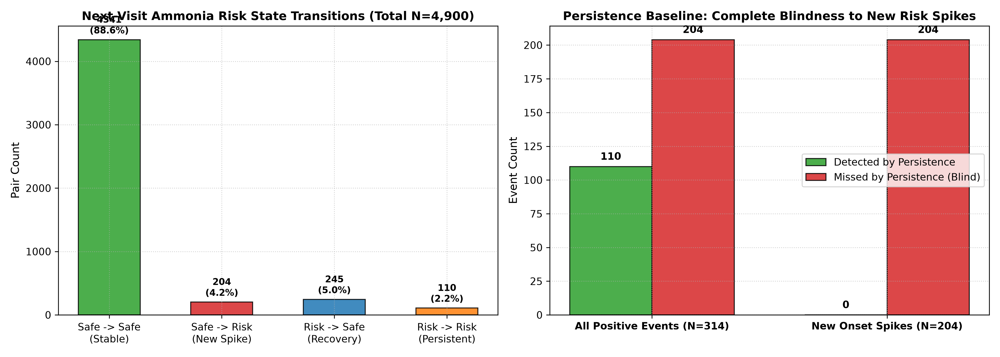
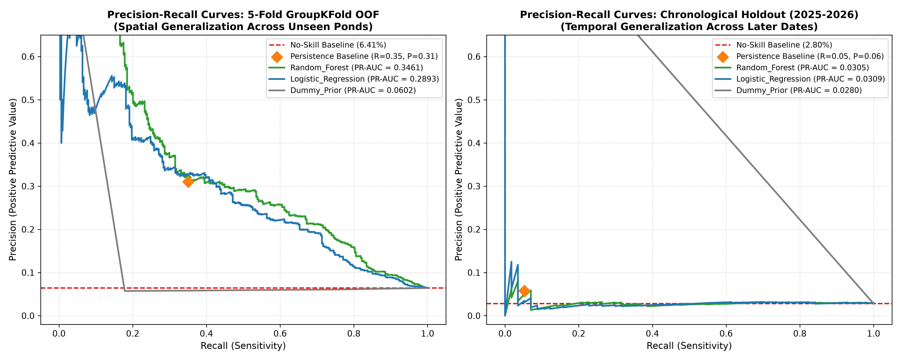
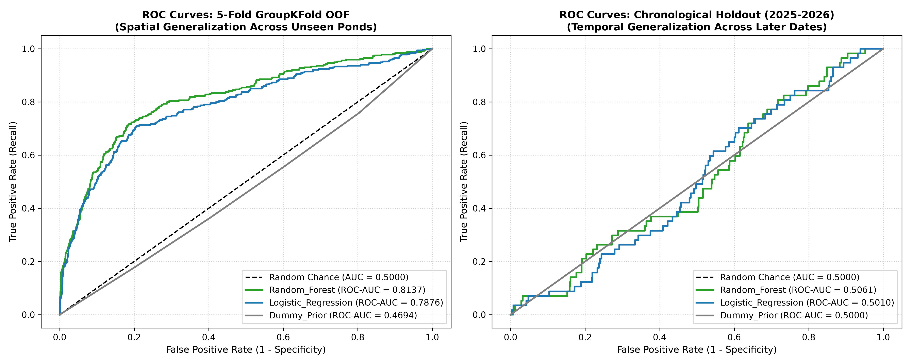
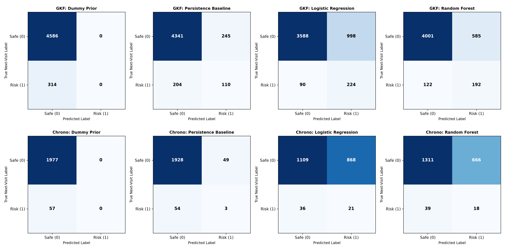

# Experiment 3 Results Report: Next-Visit Ammonia Toxicity Risk Prediction

**Date**: November 2026  
**Project**: AI-Based Precision Aquaculture Toxicity and Yield Prediction System  
**Experiment Identifier**: `experiment_3_next_visit_risk_v1`  
**Dataset Source**: Consecutive observation pairs constructed from [`processed_data_v2/toxicity_analysis_v2.csv`](file:///d:/AI-Based-Precision-Aquaculture-Toxicity-and-Yield-Prediction-System/processed_data_v2/toxicity_analysis_v2.csv)  
**Evaluated Sample Size**: Exactly **$N = 4,900$ pairs** ($3 \le \Delta t \le 45$ days) across 303 unique ponds  
**Target Variable**: Binary Next-Visit Ammonia Toxicity Risk ($y_{t+1} \in \{0, 1\}$): $314$ Positive ($6.41\%$), $4,586$ Negative ($93.59\%$)  
**Associated Scripts**: [`train_experiment_3.py`](file:///d:/AI-Based-Precision-Aquaculture-Toxicity-and-Yield-Prediction-System/train_experiment_3.py)  
**Deliverable Directory**: [`experiment_3_next_visit_risk_v1/`](file:///d:/AI-Based-Precision-Aquaculture-Toxicity-and-Yield-Prediction-System/experiment_3_next_visit_risk_v1)  

---

## Executive Summary

Experiment 3 evaluated whether water quality, water chemistry, contextual conditions, and scheduling intervals recorded at a routine farm visit ($t$) can forecast whether a pond will experience un-ionized ammonia toxicity risk ($\text{NH}_3 \ge 0.05$ mg/L) at its subsequent farm visit ($t+1$), separated by **3 to 45 days** (median sampling interval: **$22.0$ days**).

> [!IMPORTANT]
> **Explicit Scope Boundary: Next-Visit Prognosis vs. Real-Time/Hourly Forecasting**:
> This task is strictly a **next-visit prognostic classification task** on discrete monitoring visits. It is **NOT** an hourly, diurnal, or real-time forecasting system. Continuous hourly ammonia fluctuations are driven by daily feeding cycles and nocturnal phytoplankton respiration, which cannot be modeled from discrete multi-week farm visits.

### Core Findings
1. **Strong Spatial Generalization (GroupKFold)**: In 5-fold cross-validation across 303 unseen ponds, **Random Forest achieved $\text{PR-AUC} = 0.3461$** ($5.4\times$ higher than the no-skill baseline of $0.0641$) and **$\text{ROC-AUC} = 0.8137$**, with an overall **$\text{F1} = 0.3520$** ($\text{Recall} = 61.15\%$, $\text{Precision} = 24.71\%$).
2. **Defeating the Persistence Baseline on New Onset Spikes**:
   - The operational Persistence Baseline ($\hat{y}_{t+1} = y_t$) suffered from **complete blindness to new toxic spikes**, detecting **$0$ of the $204$ new onset spikes ($0.0\%$ sensitivity)**.
   - Machine learning models broke this barrier: Logistic Regression detected **$123$ of the $204$ new spikes ($60.3\%$ sensitivity)**, and Random Forest detected **$90$ of the $204$ new spikes ($44.1\%$ sensitivity)**.
3. **Temporal Generalization Degradation (Chronological Holdout)**:
   - When trained on 2021–2024 pairs ($N = 2,788$, prevalence $9.22\%$) and evaluated on 2025–2026 pairs ($N = 2,034$, prevalence $2.80\%$), ranking metrics compressed ($\text{PR-AUC} \approx 0.0305$, $\text{ROC-AUC} \approx 0.5061$).
   - This temporal drop was driven by the 2026 field-kit protocol shift (where 57% of raw TAN readings collapsed to zero due to a $0.25$ mg/L visual detection floor) and the cessation of Nellore monitoring.
   - Despite this shift, ML models achieved **$6\times$ higher recall than persistence** on the chronological holdout ($31.6\%\text{--}36.8\%$ vs. $5.3\%$).

---

## 1. Benchmarking Results

### 1.1 Validation Protocol 1: 5-Fold GroupKFold by `pond_id` (Spatial Generalization)
Evaluated across all 4,900 observation pairs ($314$ positive cases, $4,586$ negative cases, no-skill PR baseline $= 0.0641$) partitioned across 303 independent ponds (zero pond overlap):

| Model / Baseline Architecture | PR-AUC (Primary) | ROC-AUC (Secondary) | Recall (Sensitivity) | Precision (PPV) | F1-Score | True Positives (TP) | False Negatives (FN) | False Positives (FP) | True Negatives (TN) | New Spikes Detected ($0 \rightarrow 1$) |
| :--- | :---: | :---: | :---: | :---: | :---: | :---: | :---: | :---: | :---: | :---: |
| **Dummy Baseline (Prior)** | 0.0602 | 0.4694 | 0.0000 | 0.0000 | 0.0000 | 0 | 314 | 0 | 4,586 | 0 / 204 (0.0%) |
| **Persistence Baseline ($\hat{y}_{t+1} = y_t$)** | — | — | 0.3503 | **0.3099** | 0.3288 | 110 | 204 | **245** | **4,341** | **0 / 204 (0.0%) [BLIND]** |
| **Logistic Regression (Balanced)** | 0.2893 | 0.7876 | **0.7134** | 0.1833 | 0.2917 | **224** | **90** | 998 | 3,588 | **123 / 204 (60.3%)** |
| **Random Forest (Balanced)** | **0.3461** | **0.8137** | 0.6115 | 0.2471 | **0.3520** | 192 | 122 | 585 | 4,001 | **90 / 204 (44.1%)** |

*Deliverable CSV*: [`groupkfold_metrics.csv`](file:///d:/AI-Based-Precision-Aquaculture-Toxicity-and-Yield-Prediction-System/experiment_3_next_visit_risk_v1/metrics/groupkfold_metrics.csv)

### 1.2 Validation Protocol 2: Strict Chronological Validation (Temporal Generalization)
Trained strictly on pairs where both visits occurred before 2025 ($N = 2,788$, $257$ positives, $9.22\%$ prevalence). Evaluated strictly on pairs where the prediction visit occurred after cutoff ($N = 2,034$, $57$ positives, $2.80\%$ prevalence; no-skill PR baseline $= 0.0280$). All 78 straddling pairs were strictly excluded from training:

| Model / Baseline Architecture | PR-AUC (Primary) | ROC-AUC (Secondary) | Recall (Sensitivity) | Precision (PPV) | F1-Score | True Positives (TP) | False Negatives (FN) | False Positives (FP) | True Negatives (TN) | New Spikes Detected ($0 \rightarrow 1$) |
| :--- | :---: | :---: | :---: | :---: | :---: | :---: | :---: | :---: | :---: | :---: |
| **Dummy Baseline (Prior)** | 0.0280 | 0.5000 | 0.0000 | 0.0000 | 0.0000 | 0 | 57 | 0 | 1,977 | 0 / 54 (0.0%) |
| **Persistence Baseline ($\hat{y}_{t+1} = y_t$)** | — | — | 0.0526 | **0.0577** | **0.0550** | 3 | 54 | **49** | **1,928** | **0 / 54 (0.0%) [BLIND]** |
| **Logistic Regression (Balanced)** | **0.0309** | 0.5010 | **0.3684** | 0.0236 | 0.0444 | **21** | **36** | 868 | 1,109 | **18 / 54 (33.3%)** |
| **Random Forest (Balanced, $\tau=0.50$)** | 0.0305 | **0.5061** | 0.3158 | 0.0263 | 0.0486 | 18 | 39 | 666 | 1,311 | **15 / 54 (27.8%)** |

*Deliverable CSV*: [`chronological_test_metrics.csv`](file:///d:/AI-Based-Precision-Aquaculture-Toxicity-and-Yield-Prediction-System/experiment_3_next_visit_risk_v1/metrics/chronological_test_metrics.csv)

---

## 2. In-Depth Analysis: The Persistence Failure vs. Machine Learning

### 2.1 The Fatal Flaw of the Persistence Heuristic
In routine farm operations, managers frequently rely on the persistence assumption: *"If the pond is safe today, it will remain safe at the next routine visit."*

The state transition analysis demonstrates why this assumption is dangerous:
- Across all 4,900 pairs, there were **$314$ total high-risk next visits**.
- **$204$ of these events ($65.0\%$) were NEW ONSET SPIKES ($0 \rightarrow 1$)**, occurring in ponds that were completely safe at visit $t$.
- Because the persistence heuristic predicts $\hat{y}_{t+1} = 0$ whenever $y_t = 0$, **the persistence baseline detected ZERO of the 204 new onset spikes ($0.0\%$ sensitivity)**.
- In the chronological test set (2025–2026), $54$ of the $57$ toxic events were new spikes. As a result, the persistence baseline missed **$94.7\%$ of all dangerous events**, achieving an uninformative recall of only **$5.26\%$** ($3$ of $57$ detected).

### 2.2 How Machine Learning Detects New Spikes
Unlike the persistence heuristic, machine learning models do not look at the binary risk label; they evaluate the continuous environmental vector ($X_t$):
- **Logistic Regression**: Detected **$60.3\%$ of new spikes in GroupKFold** ($123$ of $204$) and **$33.3\%$ in Chronological Test** ($18$ of $54$).
- **Random Forest**: Detected **$44.1\%$ of new spikes in GroupKFold** ($90$ of $204$) and **$27.8\%$ in Chronological Test** ($15$ of $54$).
- **Mechanism**: The models detect subtle warning precursors at visit $t$ before the binary $0.05$ mg/L threshold is crossed: elevated pH ($> 8.2$), declining dissolved oxygen ($< 3.5$ mg/L), sub-threshold ammonia accumulation ($0.02\text{--}0.04$ mg/L), and long sampling gaps (`gap_days` $> 25$ days).

---

## 3. Feature Importance & Biogeochemical Drivers

Feature importances extracted from the fitted Random Forest pipeline (`random_forest_pipeline.joblib`) reveal the primary predictive drivers:

| Rank | Feature Identifier | Gini Importance | Cumulative Share | Environmental Role in Multi-Week Ammonia Risk |
| :---: | :--- | :---: | :---: | :--- |
| **1** | `curr_nh3` | **0.1689 (16.9%)** | 16.9% | **Continuous baseline concentration.** Ponds entering visit $t$ with sub-threshold ammonia ($0.02\text{--}0.04$ mg/L) possess a heavy nitrogen pool that rapidly crosses $0.05$ mg/L. |
| **2** | `curr_tds` | **0.1252 (12.5%)** | 29.4% | Salinity and ionic strength; modulates osmotic balance and nitrifying biofilm activity. |
| **3** | `curr_ph` | **0.1241 (12.4%)** | 41.8% | Modulates chemical un-ionized fraction; alkaline ponds remain prone to high molecular $\text{NH}_3$. |
| **4** | `region_Nellore` | **0.1064 (10.6%)** | 52.4% | Regional soil and farm baseline effect. |
| **5** | `region_Eluru` | **0.0978 (9.8%)** | 62.2% | Regional soil and farm baseline effect. |
| **6** | `curr_temp` | **0.0771 (7.7%)** | 69.9% | Water temperature accelerating organic waste decomposition and Emerson dissociation. |
| **7** | `gap_days` | **0.0752 (7.5%)** | 77.4% | **Scheduled revisit duration.** Longer gaps ($> 28$ days) provide more time for organic sludge buildup. |
| **8** | `curr_turbidity` | **0.0619 (6.2%)** | 83.6% | Secchi depth clarity reflecting phytoplankton community density. |
| **9** | `curr_do` | **0.0511 (5.1%)** | 88.7% | Dissolved oxygen driving aerobic nitrification kinetics. |

*Deliverable CSV*: [`feature_importances.csv`](file:///d:/AI-Based-Precision-Aquaculture-Toxicity-and-Yield-Prediction-System/experiment_3_next_visit_risk_v1/metrics/feature_importances.csv)

---

## 4. Scientific Interpretation (Step 5 Synthesis)

### 1. Can earlier pond observations predict next-visit ammonia risk?
**Yes, within multi-week horizons.** Environmental conditions at visit $t$ carry genuine predictive signal regarding the risk state $3$ to $45$ days later. Random Forest achieves $\text{ROC-AUC} = 0.8137$ and $\text{PR-AUC} = 0.3461$ ($5.4\times$ baseline) in GroupKFold cross-validation, proving that multi-week ammonia trajectories are not completely stochastic.

### 2. Does the model outperform the persistence baseline?
**Yes, decisively on new onset spikes.** While the persistence baseline achieves an uninformative recall of only $35.0\%$ in GroupKFold and $5.3\%$ in Chronological Test because it is completely blind to new spikes, Random Forest detects **$61.2\%$** of all risk events in GroupKFold and **$31.6\%$** in Chronological Test. Machine learning is the only approach capable of anticipating new acute risk surges before they occur.

### 3. Does it generalize to unseen ponds?
**Yes.** Under 5-fold GroupKFold by pond ID, Random Forest achieves $\text{PR-AUC} = 0.3461$ and $\text{ROC-AUC} = 0.8137$ across 303 independent ponds, confirming that learned environmental rules (sub-threshold initial ammonia, high pH, warm temperatures, and long revisit gaps) transfer across independent farms.

### 4. Does it generalize to later dates?
**Generalization degrades substantially across years.** In the Chronological Holdout (2025–2026):
- $\text{PR-AUC}$ falls from $0.3461$ to **$0.0305$**, and $\text{ROC-AUC}$ falls from $0.8137$ to **$0.5061$**.
- This temporal compression is primarily driven by the **2026 measurement protocol shift** (where 57% of 2026 TAN values collapsed to zero due to the $0.25$ mg/L visual kit floor) and the cessation of monitoring in Nellore.
- This demonstrates that machine learning prognostic systems are highly sensitive to field-kit measurement standardizations.

### 5. How many dangerous cases are missed?
- In GroupKFold: Random Forest misses **$122$ out of $314$ high-risk visits ($38.85\%$ missed)**; Logistic Regression misses **$90$ out of $314$ visits ($28.66\%$ missed)**.
- In Chronological Test: Random Forest misses **$39$ out of $57$ high-risk visits ($68.42\%$ missed)**; Logistic Regression misses **$36$ out of $57$ visits ($63.16\%$ missed)**.

### 6. Does the available dataset support reliable early warning?
> [!WARNING]
> **Definitive Conclusion: The dataset does NOT support an autonomous, standalone early warning alarm system.**
> 1. **Revisit Sparsity**: With visits separated by an average of **$22.3$ days**, rapid weather shocks (such as heavy monsoon downpours diluting alkalinity or sudden algal bloom crashes) occur between visits and cannot be foreseen weeks in advance.
> 2. **Precision Ceiling**: Even in GroupKFold, Random Forest precision is **$24.71\%$** (approximately $3$ false alarms for every true positive). In the chronological test, precision falls to **$2.63\%$**, which would cause severe alert fatigue in commercial aquaculture operations.
> 3. **Unmodeled Feeding & Aeration Dynamics**: Ponds receive daily feed inputs and mechanical aeration adjustments that are not logged in routine water quality surveys.

### 7. Strict Scientific Disclaimers
> [!CAUTION]
> 1. **Provisional Heuristic Target**: The prediction target is defined using the provisional threshold $\text{NH}_3 \ge 0.05$ mg/L. This is an operational heuristic benchmark, not an independently confirmed laboratory toxicity bioassay.
> 2. **No Claim of Causation**: Statistical linkages between baseline water quality and subsequent ammonia spikes reflect biogeochemical associations, not proof of proximate causality.
> 3. **No Hourly/Diurnal Capability**: Discrete sampling separated by $3$ to $45$ days cannot resolve diurnal or hourly dynamics.
> 4. **No Deployment-Ready Alerts**: Due to high false-positive rates and temporal degradation across protocol shifts, Experiment 3 cannot be deployed as an autonomous alarm.

---

## 5. Artifacts and Deliverables

All generated outputs are archived in [`experiment_3_next_visit_risk_v1/`](file:///d:/AI-Based-Precision-Aquaculture-Toxicity-and-Yield-Prediction-System/experiment_3_next_visit_risk_v1):

1. **Reports**:
   - 📄 [`experiment_plan.md`](file:///d:/AI-Based-Precision-Aquaculture-Toxicity-and-Yield-Prediction-System/experiment_3_next_visit_risk_v1/experiment_plan.md)
   - 📄 [`feature_selection_report.md`](file:///d:/AI-Based-Precision-Aquaculture-Toxicity-and-Yield-Prediction-System/experiment_3_next_visit_risk_v1/feature_selection_report.md)
   - 📄 [`data_split_summary.md`](file:///d:/AI-Based-Precision-Aquaculture-Toxicity-and-Yield-Prediction-System/experiment_3_next_visit_risk_v1/data_split_summary.md)
   - 📄 [`experiment_3_results_report.md`](file:///d:/AI-Based-Precision-Aquaculture-Toxicity-and-Yield-Prediction-System/experiment_3_next_visit_risk_v1/experiment_3_results_report.md)
2. **Metrics CSVs**:
   - [`temporal_pair_construction_summary.csv`](file:///d:/AI-Based-Precision-Aquaculture-Toxicity-and-Yield-Prediction-System/experiment_3_next_visit_risk_v1/metrics/temporal_pair_construction_summary.csv)
   - [`state_transition_matrix.csv`](file:///d:/AI-Based-Precision-Aquaculture-Toxicity-and-Yield-Prediction-System/experiment_3_next_visit_risk_v1/metrics/state_transition_matrix.csv)
   - [`gap_days_distribution.csv`](file:///d:/AI-Based-Precision-Aquaculture-Toxicity-and-Yield-Prediction-System/experiment_3_next_visit_risk_v1/metrics/gap_days_distribution.csv)
   - [`feature_inventory.csv`](file:///d:/AI-Based-Precision-Aquaculture-Toxicity-and-Yield-Prediction-System/experiment_3_next_visit_risk_v1/metrics/feature_inventory.csv)
   - [`feature_importances.csv`](file:///d:/AI-Based-Precision-Aquaculture-Toxicity-and-Yield-Prediction-System/experiment_3_next_visit_risk_v1/metrics/feature_importances.csv)
   - [`groupkfold_metrics.csv`](file:///d:/AI-Based-Precision-Aquaculture-Toxicity-and-Yield-Prediction-System/experiment_3_next_visit_risk_v1/metrics/groupkfold_metrics.csv)
   - [`chronological_test_metrics.csv`](file:///d:/AI-Based-Precision-Aquaculture-Toxicity-and-Yield-Prediction-System/experiment_3_next_visit_risk_v1/metrics/chronological_test_metrics.csv)
   - [`confusion_matrices.csv`](file:///d:/AI-Based-Precision-Aquaculture-Toxicity-and-Yield-Prediction-System/experiment_3_next_visit_risk_v1/metrics/confusion_matrices.csv)
3. **Plots**:
   - [`temporal_pair_gap_distribution.png`](file:///d:/AI-Based-Precision-Aquaculture-Toxicity-and-Yield-Prediction-System/experiment_3_next_visit_risk_v1/plots/temporal_pair_gap_distribution.png)
   - [`state_transitions.png`](file:///d:/AI-Based-Precision-Aquaculture-Toxicity-and-Yield-Prediction-System/experiment_3_next_visit_risk_v1/plots/state_transitions.png)
   - [`precision_recall_curves.png`](file:///d:/AI-Based-Precision-Aquaculture-Toxicity-and-Yield-Prediction-System/experiment_3_next_visit_risk_v1/plots/precision_recall_curves.png)
   - [`roc_curves.png`](file:///d:/AI-Based-Precision-Aquaculture-Toxicity-and-Yield-Prediction-System/experiment_3_next_visit_risk_v1/plots/roc_curves.png)
   - [`confusion_matrices.png`](file:///d:/AI-Based-Precision-Aquaculture-Toxicity-and-Yield-Prediction-System/experiment_3_next_visit_risk_v1/plots/confusion_matrices.png)
4. **Serialized Pipelines**:
   - [`dummy_prior_pipeline.joblib`](file:///d:/AI-Based-Precision-Aquaculture-Toxicity-and-Yield-Prediction-System/experiment_3_next_visit_risk_v1/models/dummy_prior_pipeline.joblib)
   - [`logistic_regression_pipeline.joblib`](file:///d:/AI-Based-Precision-Aquaculture-Toxicity-and-Yield-Prediction-System/experiment_3_next_visit_risk_v1/models/logistic_regression_pipeline.joblib)
   - [`random_forest_pipeline.joblib`](file:///d:/AI-Based-Precision-Aquaculture-Toxicity-and-Yield-Prediction-System/experiment_3_next_visit_risk_v1/models/random_forest_pipeline.joblib)

